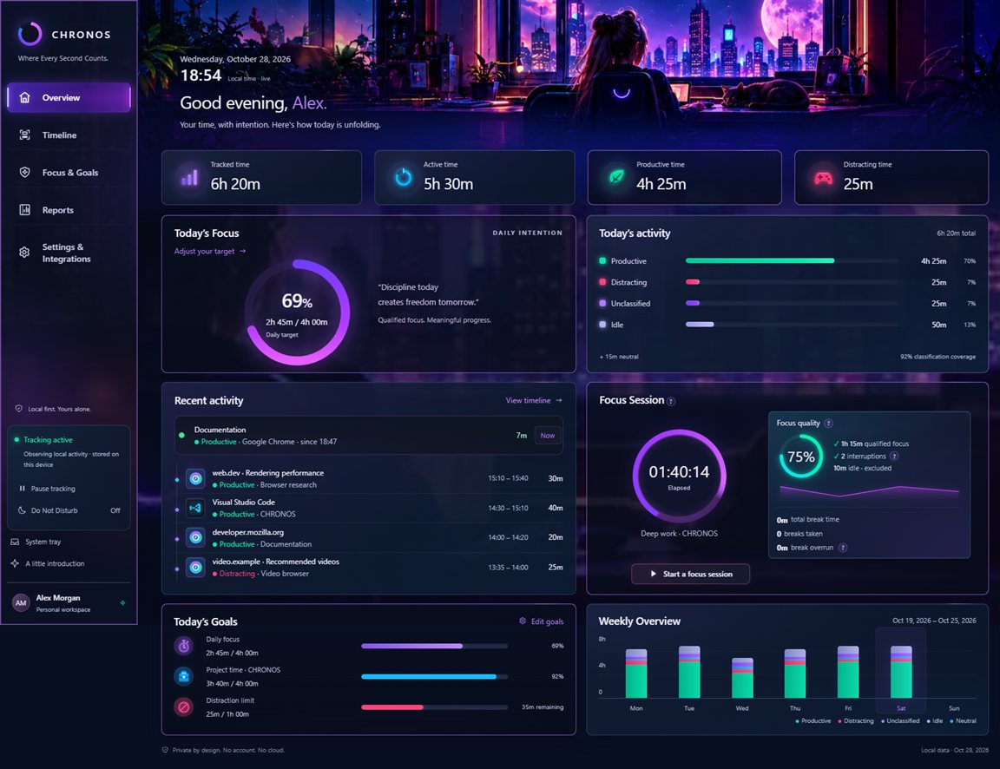
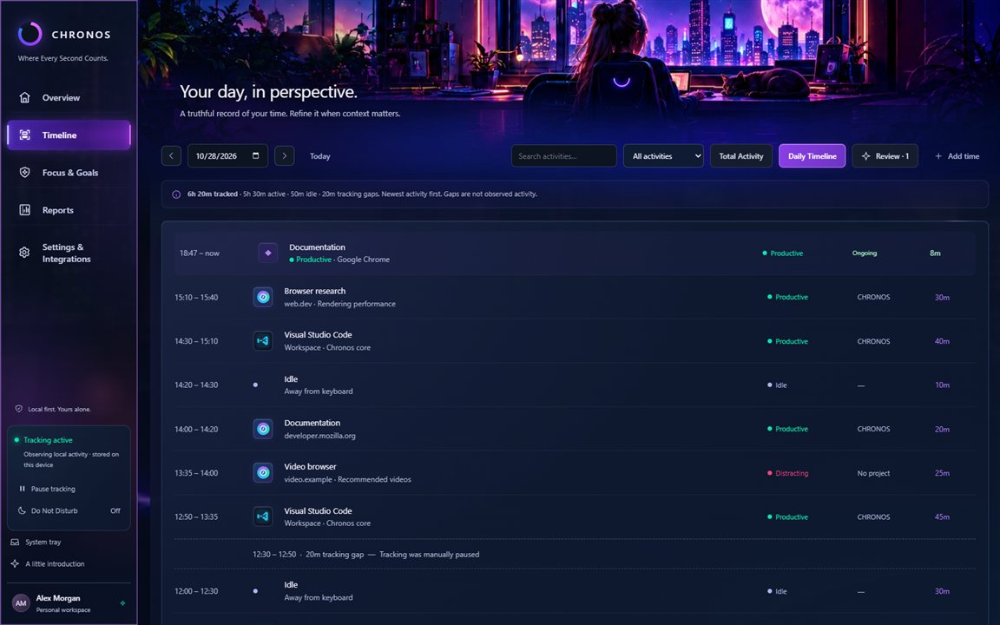
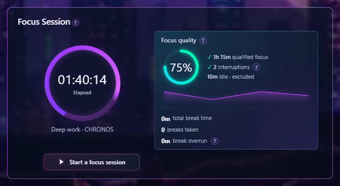
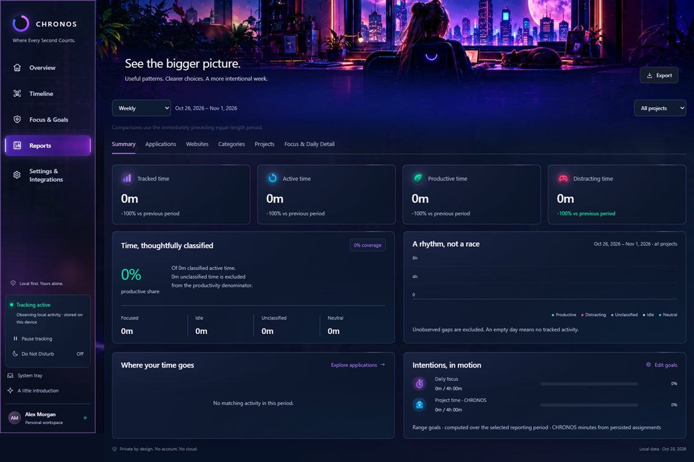
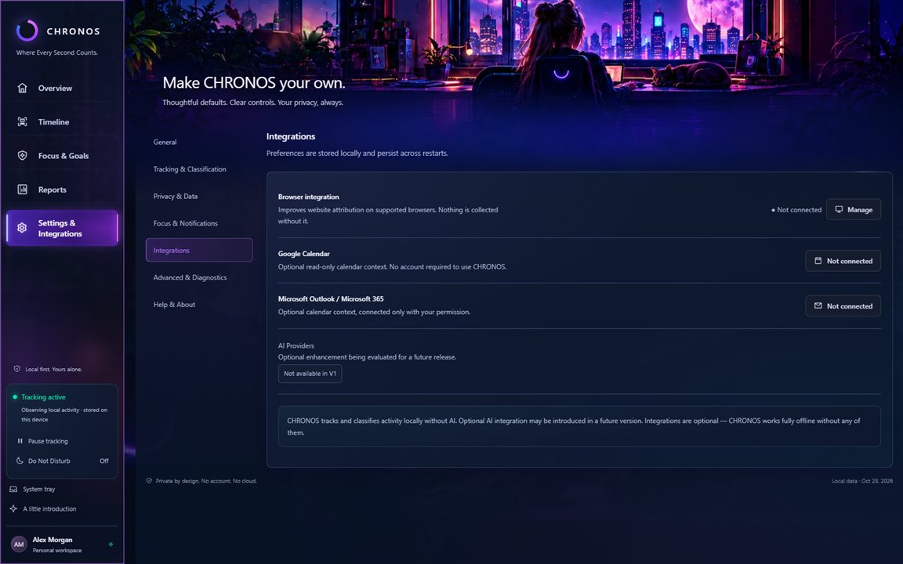

<p align="center">
  
</p>

<h1 align="center">CHRONOS</h1>

<p align="center">
  <strong>Know Your Time. Live It Better.</strong><br/>
  A local-first personal time tracker for Windows — private by design, honest by construction.
</p>

<p align="center">
  <a href="#-install-on-windows">Install</a> ·
  <a href="#-browser-companion-optional">Browser companion</a> ·
  <a href="#-privacy--local-first">Privacy</a> ·
  <a href="#%EF%B8%8F-platforms">Platforms</a> ·
  <a href="#%EF%B8%8F-building-from-source">Build</a> ·
  <a href="docs/V1-RELEASE-NOTES.md">Release notes</a> ·
  <a href="LICENSE">MIT License</a>
</p>

<p align="center">
  
</p>

## What is CHRONOS?

CHRONOS quietly observes how you spend time at your computer and turns it
into an honest, private record — a local SQLite database you own, with no
account, no cloud sync, and no telemetry. A Rust core with native platform
adapters records the foreground application (and, with the optional browser
companion, the active website), classifies activity, and surfaces it through
a fast React interface: live activity, a precise timeline, focus sessions
with honest statistics, projects, goals, and reports.

The timer alone never counts as focus. CHRONOS measures what you actually
did — observed productive activity — and keeps idle time, breaks, and
elapsed time clearly separated.

## Highlights

- **Automatic activity tracking** — the foreground application is observed
  natively (WinEvent hook on Windows) with idle detection, pause/privacy
  modes, scheduled tracking windows, and honest gap recording.
- **Live everywhere** — a "Right now" card ticks in real time, and the
  optional Mini CHRONOS floating bar keeps the current activity one glance
  away.
- **Timeline** — one expandable entry per application, or a chronological
  daily view with ongoing rows, search, filters, per-interval correction,
  and manual time entry.
- **Focus Sessions** — a phase-countdown dial, automatic pause when you
  step away (with the preserved time waiting for your explicit resume),
  scheduled breaks with honest accounting — planned, extensions, actual
  duration, and overrun — plus break statistics and contextual help.
- **Qualified focus, not wishful thinking** — focus counts only observed
  productive activity, inside sessions or in sustained 5-minute-plus
  productive stretches.
- **Projects, goals & reports** — project attribution (rules and learned),
  daily/weekly goals with a distraction limit, and reports across
  categories, websites, projects, clients, work sessions, and focus detail.
- **A real classification engine** — a built-in catalog, user rules,
  learned attribution, privacy-safe detail (sensitive apps never store
  window titles), and a review queue for low-confidence entries.
- **Privacy controls** — privacy mode, per-app/website exclusions, local
  backups with restore, CSV/JSON export, retention sweeps, and a data
  location you can inspect with any SQLite tool.

<table>
  <tr>
    <td></td>
    <td></td>
  </tr>
  <tr>
    <td align="center">Daily Timeline</td>
    <td align="center">Focus Session</td>
  </tr>
  <tr>
    <td></td>
    <td></td>
  </tr>
  <tr>
    <td align="center">Reports</td>
    <td align="center">Settings & Integrations</td>
  </tr>
</table>

## 📥 Install on Windows

1. Download **`CHRONOS-Windows-Setup.exe`** from the
   [latest release](../../releases/latest) and check it against the
   published SHA-256 checksum.
2. Run the installer. CHRONOS installs per-machine (to
   `C:\Program Files\CHRONOS`) and relies on Microsoft's WebView2 runtime,
   which the installer sets up if needed.
3. Launch CHRONOS. A short introduction explains the model — tracking
   starts only after you explicitly enable it.

> **SmartScreen note:** the installer is not code-signed (no signing
> certificate has been purchased for this project yet), so Windows may show
> "Windows protected your PC". Verify the downloaded file's SHA-256 against
> the checksum published on the release page, then choose *More info → Run
> anyway*. We recommend keeping all Windows security features enabled.

Requirements: Windows 10 or 11 (64-bit). Your data lives in
`%APPDATA%\app.chronos.desktop\chronos\` — a single SQLite database plus
local backups and exports you control.

## 🧩 Browser companion (optional)

CHRONOS's website attribution and distraction blocking work through a small,
open-source browser extension that reports **only the active tab's domain**
to the local app — no page content, no keystrokes, nothing leaves your
machine.

1. In CHRONOS, open **Settings & Integrations → Integrations → Connect** and
   pick your browser for guided steps.
2. Load the extension unpacked (Chrome/Edge/Brave/Zen: Developer mode →
   *Load unpacked* from the `browser-extension/` folder here or the
   release zip; Firefox: *Temporary Add-on* from `browser-extension-firefox/`).
3. The local pairing page completes automatically — no tokens to copy.
   Status turns **Communicating** while you browse, and website rows appear
   on your Timeline.

## 🔒 Privacy & local-first

- **No account, no cloud, no telemetry.** CHRONOS never sends your data
  anywhere. The only network listener is a localhost endpoint used by the
  optional browser companion.
- **Minimal, honest collection:** application names, optional window-title
  context (sanitized for sensitive apps like browsers — domains or curated
  service labels only), idle periods, and gaps. No screenshots, no
  keystrokes.
- **You own the data:** inspect, export (CSV/JSON), back up, restore, or
  delete the SQLite database at any time. Retention sweeps can prune old
  history automatically.
- **Privacy mode** pauses all collection instantly and records nothing —
  not even idle rows — until you leave it.

## 🖥️ Platforms

| Platform | Status |
| --- | --- |
| Windows 10/11 (64-bit) | ✅ **Available** — [download the installer](../../releases/latest) |
| macOS | 🚧 In development — the native adapter and CI build exist; no public installer yet |
| Linux (X11 / Hyprland) | 🚧 In development — adapters exist; no public installer yet |

macOS and Linux have real platform adapters in the source tree, but neither
has completed acceptance testing or a public build. No installers are
offered for them today, and none are claimed.

## 🛠️ Building from source

Prerequisites: Rust (stable), Node.js 20+.

```bash
npm install          # frontend dependencies
npm run tauri dev    # run the desktop app in dev mode
```

Verification used during development:

```bash
npm run typecheck    # TypeScript
npm test             # frontend tests (vitest)
cargo test           # Rust domain tests (run inside src-tauri)
npx tauri build      # release build + installers
```

CI workflows under `.github/workflows/` build and test all three platforms.

## Repository layout

```
src/                 React + TypeScript interface
src-tauri/           Rust core: tracker, classifier, accounting, SQLite,
                     backup, integrations, commands
  src/tracker/       platform adapters (windows.rs, macos.rs, linux.rs)
browser-extension/   optional website-attribution companion (Chromium)
browser-extension-firefox/   Firefox variant
docs/                release notes, tester guide, screenshots, brand
```

## Documentation

- [Release notes](docs/V1-RELEASE-NOTES.md) — every version, in detail
- [Tester guide](docs/TESTER-GUIDE.md) — hands-on verification handbook
- [Third-party notices](THIRD-PARTY-NOTICES.md) — dependency licensing and artwork attribution
- [Security policy](SECURITY.md) — how to report issues privately

## License

CHRONOS is released under the [MIT License](LICENSE). The bundled artwork
and icons were created for this project with AI image-generation tools and
are distributed with it; see [Third-party notices](THIRD-PARTY-NOTICES.md).

---

<p align="center"><em>Local first. Yours alone.</em></p>
